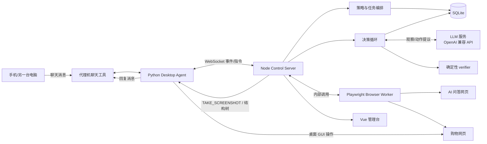
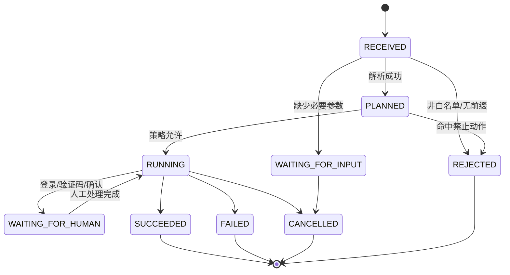

# 系统架构

## 1. 总体方案

系统采用单机分层架构。Node.js 控制服务是任务和策略的唯一事实源，并**拥有决策循环**
（ADR-010）：由 LLM 依据观察提议下一个白名单动作，提议经校验后下发。Python Desktop
Agent 使用 pywinauto，专注 Windows 桌面能力；Playwright Worker 专注浏览器页面。
两类执行器都只接受强类型、白名单动作。



`决策循环`与`LLM 服务`为方案 B 新增（见 [`14-plan-b-design.md`](14-plan-b-design.md)）。
购物链路的默认操作层面是**桌面 GUI**（AI 用鼠标键盘操作浏览器），Playwright 作为
稳定站点的可选快路径与观察来源。

## 2. 为什么这样拆分

- Python/pywinauto 同时提供 Win32 与 UIA backend，满足课程指定技术路线。
- Node.js/TypeScript 与 Playwright 集成成熟，适合 DOM 自动化和快速编排。
- 工作流集中在 Control Server，避免 Python 和 Node 各自维护一套任务状态。
- SQLite 满足单代理机课程项目，无需引入数据库运维。
- 本地 HTTP/WebSocket 足够清晰，便于抓包、测试和答辩展示。

## 3. 组件职责

### 3.1 Control Server

- 接收 Agent 上报的聊天消息。
- 去重、解析命令、创建任务。
- 执行策略校验与状态机转换。
- 调度桌面动作或浏览器动作。
- **拥有决策循环**：采集观察、向 LLM 请求动作提议、校验提议、下发命令、调用 verifier
  判定是否完成，并在预算耗尽时终止（ADR-010）。
- 汇总结果并生成待回复文本。
- 提供管理 API、WebSocket 状态流和健康检查。
- 独占 SQLite 写入权。

建议模块：

```text
src/
  api/             # HTTP、WebSocket、鉴权
  application/     # 用例、任务编排、决策循环、verifier
  domain/          # Task、Step、Policy、状态机、决策动作与轨迹
  adapters/
    browser/       # AI/购物站点适配器与页面观察
    desktop/       # Desktop Agent 客户端
    llm/           # LLM 动作提议适配器（OpenAI 兼容）
  infrastructure/ # SQLite、日志、配置
```

决策循环的职责边界（详细设计见 [`14`](14-plan-b-design.md)）：

- **只提议，不执行**：循环本身不直接驱动输入，一切输入经既有 `desktop.command` 通道
  下发，因此 Server/Agent 双重策略校验与幂等保护继续生效。
- **观察层**：把 Desktop Agent 的 UIA 结构树与截图转成有长度上限的受限文本表示，
  并显式标注其中的不可信内容。
- **校验层**：LLM 输出经 JSON Schema → 动作白名单 → 参数范围 → 策略引擎 → 目标允许
  列表逐级校验，任一步失败即丢弃提议，不做"尽力修正"。
- **判定层**：成功由确定性 verifier 判定，LLM 自述完成不构成成功。

### 3.2 Desktop Agent

- 发现和连接指定 Windows 应用。
- 读取聊天窗口中的新消息。
- 驱动窗口、控件、键盘、鼠标和剪贴板。
- **提供观察能力**：上报有节点数上限的 UIA 结构树（供决策循环作为"眼睛"），
  并截图留证。
- 执行紧急停止热键。
- 拒绝未知动作、过期指令和重复指令。

**不做的事（方案 B 下仍然成立）**：Agent 只接管**已运行**的白名单进程窗口，
**不负责启动程序**，也不接受文件路径。因此决策循环要操作浏览器或 AI 页面，必须先由
人工或启动脚本把目标应用打开——这一缺口及其候选方案见
[`14-plan-b-design.md`](14-plan-b-design.md) §8 D11（R-17）。

当前模块边界（C# 链路已随 ADR-009 移除，不再有迁移期并行实现）：

```text
apps/
  desktop-agent-python/
    src/desktop_agent/      # 目标协议、连接、调度、安全和 Adapter
    tests/                  # pytest 契约与行为测试
```

Python Agent 的协议、校验、调度与策略层必须可在 macOS/Linux CI 中验证；
pywinauto、Windows 输入、剪贴板、截图和微信 Adapter 必须隔离在 Windows Adapter
中。C# Desktop Agent 已确定移除（见 ADR-009），不再作为参考实现或回退基线，
未实现动作必须返回 `NOT_IMPLEMENTED`，
不得模拟执行成功。

**Agent 保持"只执行白名单动作"的单一职责**：Agent 内不引入 LLM、不做决策、不维护
任务状态。决策循环位于 Control Server（ADR-010），因此 Agent 的安全边界无需放宽。

观察能力的隐私约束：运行时的结构树节点 Name 会传给 LLM 以支撑决策，但
**持久化轨迹与日志中的 Name 必须脱敏**（沿用 `uia_inspection.py` 的 HMAC 做法），
截图按现有保留策略清理。传参与留证是两条不同通路，不得把原始名称长期落库。

### 3.3 Browser Worker

**实现状态：尚未实现。** `apps/control-server` 当前不含任何 Playwright 代码，本节是
设计目标而非现状；真实浏览器 Adapter 属未验证项（见
[`08-development-status.md`](08-development-status.md)）。

方案 B 下商品链路的默认操作层面是**桌面 GUI**（AI 用鼠标键盘操作浏览器，ADR-010），
因此 Browser Worker 的定位调整为**可选快路径与观察来源**，不再是购物主路径的必经组件：

- 管理持久化浏览器上下文。
- 对 AI 页面执行提问和结果提取。
- 对购物页面执行检索和结构化抽取，并可作为页面观察（accessibility tree）的来源。
- 保存 Playwright trace、截图和页面诊断信息。
- 遇到验证码或登录失效时转为 `WAITING_FOR_HUMAN`。

每个站点实现独立 Adapter，不允许工作流直接使用 CSS 选择器。

### 3.4 Operator Web

- 展示 Agent 在线状态、当前任务和步骤时间线。
- 支持暂停接单、取消任务、紧急停止。
- 查看脱敏截图和失败原因。
- 配置联系人白名单、命令前缀、站点开关与保留期。

管理台只在本机开放。课程演示若需局域网访问，必须启用口令并限制来源地址。

## 4. 自动化策略

定位优先级：

1. **语义控件**：UIA `AutomationId/Name/ControlType`。
2. **DOM**：Playwright `getByRole/getByLabel/getByText`。
3. **锚点相对位置**：以可识别窗口或控件为基准。
4. **固定坐标**：仅限 PoC，必须校验分辨率、缩放和前台窗口。

每个动作执行前后都要断言页面/窗口状态。例如“点击发送”前确认前台进程是微信且输入框内容匹配，执行后确认消息出现在会话中。

## 5. 核心工作流



状态语义在方案 B 下的两处澄清（与 `docs/10` §3 一致）：

- `PLANNED` 表示"已生成执行计划"，即固定步骤**或**决策循环的预算与任务规格；
  决策循环的步骤数量在运行前不可知，因此不得在 `PLANNED` 阶段假设步骤总数
  （待 `docs/14` §8 D12 正式收口）。
- `RUNNING → WAITING_FOR_HUMAN` 的触发原因除登录/验证码/确认外，**新增决策预算耗尽
  与无法取得有效提议**（`DECISION_BUDGET_EXHAUSTED`、`PROPOSAL_REJECTED` 连续失败、
  `LLM_UNAVAILABLE`、`OBSERVATION_INSUFFICIENT`）。图中不单独画出，以避免状态图
  膨胀；该转换复用既有边。

### 5.1 决策循环路径（默认，ADR-010）

```text
RECEIVED → 策略/前缀/去重校验 → PLANNED → RUNNING
  ┌─→ 1. observation：采集结构树（必要时截图）
  │   2. LLM 提议下一个白名单动作（结构化 JSON）
  │   3. 校验：Schema → 动作白名单 → 参数范围 → 策略 → 目标允许列表
  │      任一步失败即丢弃该提议，记录原因并重新提议
  │   4. 经 desktop.command 下发执行（双重策略校验与幂等继续生效）
  │   5. verifier 判定后置条件是否满足
  └─── 未满足且预算未耗尽则回到 1
预算耗尽 / 无法取得有效提议 → WAITING_FOR_HUMAN
verifier 通过 → SUCCEEDED
```

预算为轮次、wall-clock 与 token 三重上限（FR-14）。循环内**不得**绕过
`desktop.command` 直接执行动作，也不得因 LLM 输出而改变任务状态。

### 5.2 确定性快捷路径（保留）

原固定八步商品工作流保留为"有把握时走的路径"与演示兜底：

1. `ParseShoppingRequest`
2. `ValidateShoppingPolicy`
3. `OpenShoppingSite`
4. `SearchProducts`
5. `ExtractCandidates`
6. `RankCandidates`
7. `SummarizeResults`
8. `SendChatReply`

两者关系：快捷路径用于站点结构稳定、定位器有效时的确定性执行；当定位失效、界面
未预见过或用户指令超出模板时，转入决策循环。**两条路径共享同一套动作白名单、策略
校验与 verifier**，不得为决策路径放宽任何校验。

原有的"AI 不得跳过、插入或改写这些步骤"约束**已由 ADR-010 解除**，仅对快捷路径
自身成立（快捷路径内部仍按固定顺序执行）。

## 6. 意图理解方案

意图理解采用"规则为主、LLM 补足"的两级方案（ADR-010）：

- 命令前缀和动词由规则识别（决定任务类型与是否受理）。
- 金额、数量等关键字段优先由确定性解析器提取。
- 规则无法解析或描述复杂时，交由 LLM 转为候选结构；**LLM 的解析结果与动作提议走
  同一条校验链**，必须通过 JSON Schema、业务范围和策略校验。
- 校验失败则向用户追问，不猜测预算、数量或高风险意图。

安全前提：无论由规则还是 LLM 解析，**是否受理、是否允许执行**这一判定始终由确定性
策略层做出，LLM 输出不能改变策略判定。

## 7. 排序策略

首期不声称“全网最优”，只在当次抓取候选中排序。默认评分：

```text
score =
  0.35 * preferenceMatch +
  0.25 * ratingScore +
  0.20 * salesScore +
  0.20 * priceScore
```

所有子分数归一化到 `[0, 1]`，页面缺失字段按中性值或降权处理，并在回复中说明排序范围和采集时间。

## 8. 可靠性机制

- 消息以 `source + conversationId + messageId` 幂等。
- 同一 Agent 默认串行执行任务，避免争夺鼠标和前台窗口。
- 步骤设置独立超时；仅只读且可幂等的步骤允许自动重试。
- 每次执行动作携带 `commandId` 和有效期，Agent 维护最近执行集合。
- Agent 使用 Server 下发的心跳间隔，连续缺失三次心跳后由 Server 标记离线。
- Agent 断线后按有上限的指数退避重连；新连接替换相同 Agent 的旧连接。
- 进程重启后运行中任务转为 `INTERRUPTED`，由管理员决定重试。
- UI 定位规则带 `adapterVersion`，便于定位软件升级造成的失败。

## 9. 安全边界

Control Server 在下发动作前和 Desktop Agent 在执行前各校验一次：

- 动作类型在白名单中。
- 目标进程、窗口标题和站点域名匹配允许列表。
- 不属于支付、转账、凭据读取、文件删除等禁止动作。
- 当前任务未取消且指令未过期。
- 需要确认的动作已存在有效确认记录。

引入 LLM 后追加的边界（ADR-010，方案 B）：

- **LLM 无执行权**：LLM 只输出动作提议，提议必须通过与固定工作流相同的全部校验；
  LLM 不得产生代码、脚本、文件路径、URL 跳转或直发用户的文本。
- **提示注入按一等威胁处理**：结构树、网页与聊天正文中的文本一律作为**数据**注入
  观察，不得被视为指令。防线为"标记不可信 + LLM 无权限 + 动作白名单 + 策略双检 +
  禁止动作清单"，不依赖提示词本身的健壮性。
- **禁止动作清单对 LLM 同样生效**，且校验发生在执行前而非提示层。
- **三重预算**限制循环轮次、wall-clock 与 token 消耗，防止失控循环。
- 观察内容与决策轨迹**脱敏后**才入库；原始节点名称不长期保留。

紧急停止应同时做到：清空待执行队列、终止决策循环、释放输入状态、停止浏览器步骤、
暂停接收新任务。

## 10. 部署拓扑

MVP 所有组件运行在一台 Windows 11 代理机：

```text
Windows 11
├── Chat client (Desktop)
├── Chromium (Playwright persistent context，可选快路径)
├── Python Desktop Agent (pywinauto)
├── node control-server (含决策循环)
├── operator-web static files
└── data/automation.db + artifacts/
```

LLM 通过 OpenAI 兼容的 HTTPS API 访问（`LLM_API_BASE` / `LLM_API_KEY` / `LLM_MODEL`），
不在本机部署模型；密钥只经环境变量注入，禁止写入配置或日志。决策循环依赖外网时，
演示必须具备确定性快捷路径兜底。

不建议把控制服务部署到公网。远程用户通过聊天工具间接使用系统，降低网络和认证复杂度。
